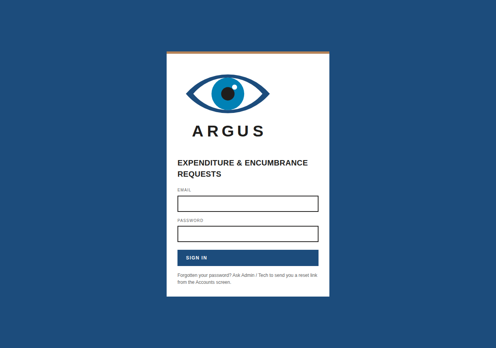
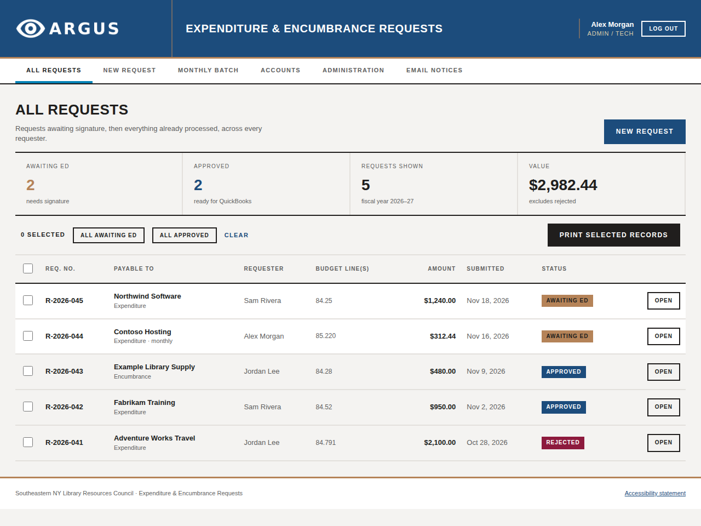
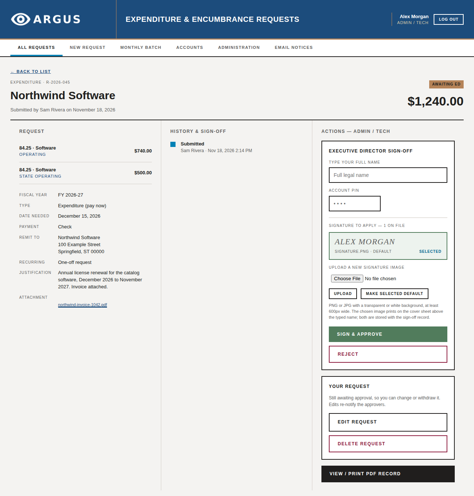
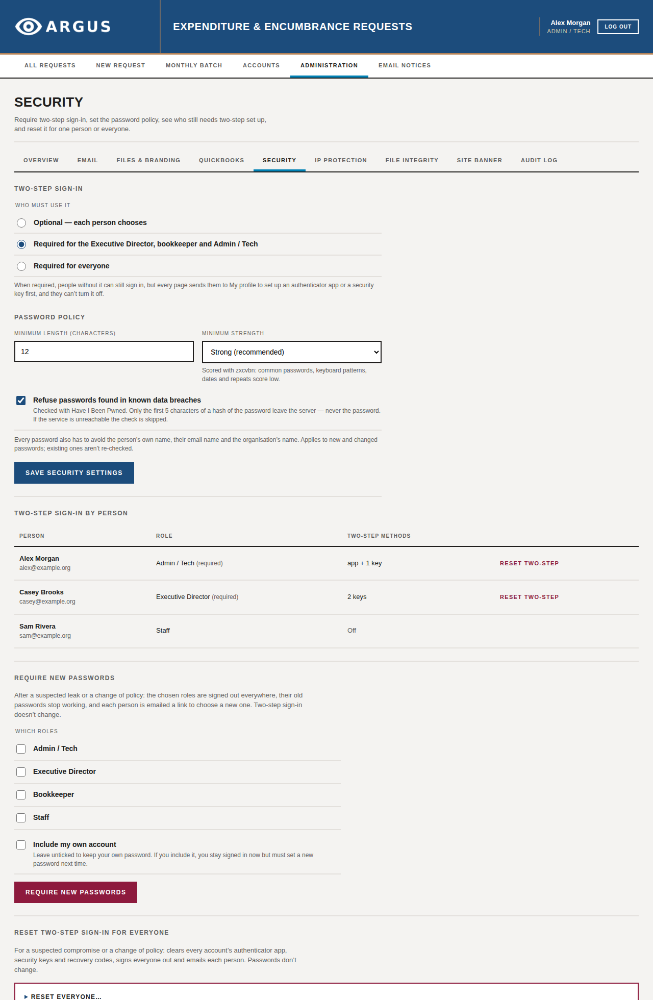
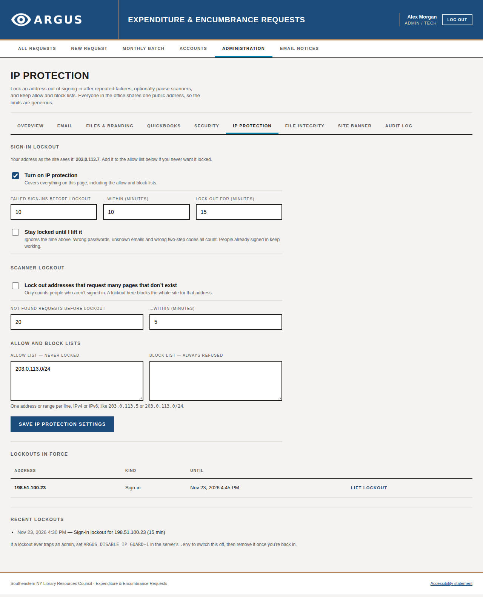
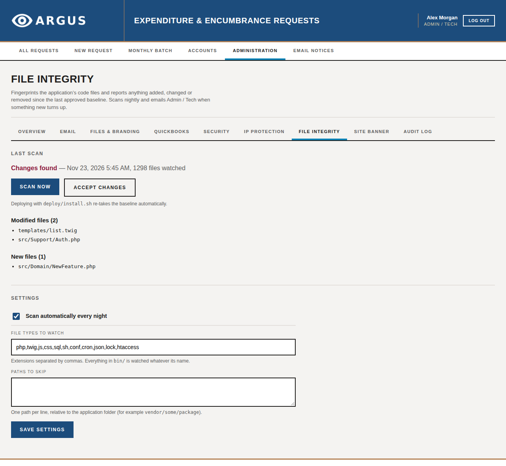

# Expenditure & Encumbrance Request System

Built from the design handoff bundle in `design_handoff_expense_requests/` (the
prototype `Expense Requests.dc.html` + `build-notes.md`) for Southeastern NY
Library Resources Council. Plain PHP 8.2 + MySQL 8 on Apache — no build step,
no JS framework, matching the handoff's stated weight for an 8-person
internal tool.

## About Argus

In Greek myth, Argus Panoptes was the giant with a hundred eyes: never all
asleep at once, always someone watching. That is what this system is for.
Every expenditure or encumbrance request, approval, signature and change is
recorded, and the system keeps an eye on itself too (an append-only audit log,
a file-integrity monitor, sign-in lockouts). The name also doesn't advertise
what the server holds, which is why it isn't called "expenses" or "finance".
The logo is an open eye for the same reason.

## Screenshots

Fictional demo data.

| | |
|---|---|
|  |  |
| Sign-in | The request queue, with status and totals |
|  |  |
| A request, awaiting the Executive Director's signature | Two-step sign-in and password policy |
|  |  |
| IP lockouts and allow/block lists | File integrity monitor |

## Setup & deployment

Production is **Argus** — `https://argus.example.org`, Ubuntu 24.04 server
(Apache + PHP 8.3, shared with other sites), code at
`/var/www/argus/`, database on **Amazon RDS** (MySQL, TLS required), mail via
the server's local **Postfix**. Development happens in this folder; the files
are copied to the server by hand.

**Every time you copy new code onto the server**, run:

```bash
cd /var/www/argus && sudo bash deploy/install.sh
```

It installs Composer dependencies, fixes ownership/permissions, clears the
template cache, installs the cron file and reloads Apache (only if
`apache2ctl configtest` passes — a bad config never takes the other sites
down). It only touches the database — and only then asks for the RDS admin
(master) login — when there's something to do: first install, a new file in
`db/migrations/`, or the app's own DB login not working. Use `--db` to force
the database step, `--no-seed` on a first install to skip the dev seed data.

**Server settings live in `/var/www/argus/.env`** (template: `.env.example`):
DB host/port/name/user/password, base URL, optional SMTP overrides. The first
install creates it and generates the app's DB password; code updates never
overwrite it. It is `root:www-data 640`, outside the web root, and never in
this dev folder or git. (`config/secrets.php`, the earlier mechanism, is
migrated into `.env` and removed automatically.)

**Database changes** go in a new `db/migrations/NNN_description.sql` file —
never edit `db/schema.sql` for an existing install. `install.sh` applies each
migration once, records it in `schema_migrations`, and re-applies the app
user's per-table grants (data rights only; `audit_log` is SELECT + INSERT so
the audit trail is append-only).

**Shared servers.** `.env` (database password, `APP_KEY`) is readable by the account PHP runs
as. If other PHP sites run as that same account, give Argus its own: create the user
(`adduser --system --group --no-create-home argus`), add a php-fpm pool for it
(`deploy/php-fpm-pool.conf.example`), point this vhost at the pool (the commented block in
`deploy/vhost.conf`), then install once with `sudo WEB_USER=argus bash deploy/install.sh`.
The installer then owns `.env`, `storage/` and the cron jobs as that user and **records it in
`.env` as `ARGUS_WEB_USER`**, so later updates run as the same account even if the variable is
left out (pass `WEB_USER=` again to change it). Before changing any ownership it checks that a
php-fpm pool is really running as that user and stops if not, because under `mod_php` PHP runs
as Apache's own account, which couldn't read the files. `SKIP_RUNTIME_CHECK=1` overrides the
check. Per-site `open_basedir` helps but is not a substitute for a separate user.

**One-time server setup** (already done on the production server): Apache modules
`ssl headers rewrite`, the vhost from `deploy/vhost.conf` (site file
`argus.conf`, bound to the server's private IP, office-IP `Require ip`, per-site PHP
hardening incl. `open_basedir` and 21M uploads), and the Let's Encrypt
certificate via `certbot certonly --webroot` (steps in the vhost header).
The RDS security group must allow the server on 3306.

### Dev-only seed credentials

(Production: migration 008 removed the sample data once real accounts existed.)

The dev seed (`install.sh --seed`, off by default) gives every account one
shared login password and the approver accounts one shared sign-off PIN,
both documented in `db/seed.sql`. They are for local testing only. **Reset every one of these from the Accounts
screen before go-live** — each Reset issues a fresh 48-hour set-password
link and clears the PIN.

The three seeded signature images (the Director's full signature + initials,
Bookkeeper's signature) are also placeholders generated by
`signatures:seed-placeholders` — plain rectangles with a typed name, not real
signatures. Replace them by uploading real ones from the sign-off panel on
any pending request (or reset and let people upload their own).

### First admin account (if not using the seed data)

```bash
php bin/console user:create-admin you@example.org "Your Name"
```

## Security and accessibility

- Sign-in: password policy (length, strength, personal-word and breached-password checks),
  per-account and per-IP lockouts, optional two-step sign-in (authenticator app, security
  keys and passkeys, recovery codes), sessions ended on security changes.
- Every state-changing request is CSRF-protected and uses prepared statements; uploads are
  validated by content, stored outside the web root and served through authenticated handlers;
  signature images are re-encoded; approvals need the approver's PIN and signature.
- An append-only audit trail, a file-integrity monitor and security response headers.
- Built to WCAG 2.1 AA (semantic markup, labelled controls, visible focus, announced
  messages, accessible tables); see the in-app `/accessibility` statement for what has and
  has not been independently tested.
- Server-level hardening (PHP settings, file permissions, a least-privilege database user,
  an IP allow list in the web server) is deployment work: see `deploy/`.

## Accounts, roles and budget-line access

There are four roles. Role changes (ED, bookkeeper, admin) can only be made by Admin / Tech.

| Role | Can do | Budget lines it can use |
|---|---|---|
| **Staff** | Submit requests; edit or delete their own while still awaiting approval | Shared lines and the lines assigned to them |
| **Executive Director** | Approve or reject with a signature and PIN; manage staff accounts | Every line |
| **Bookkeeper** | See and print every request (payment is done in QuickBooks); manage staff accounts | Every line |
| **Admin / Tech** | Everything, including accounts, budget lines, security and the audit log | Every line until lines are assigned to them, then only those plus the shared ones |

**Who can use which budget line**

- A **shared** line is usable by everyone (travel, postage and building lines are pre-marked
  by migration 003; toggle per line under Administration).
- **Staff** can use a line only if it is shared or assigned to them. A new staff account with
  nothing assigned therefore sees **only the shared lines**: it fails closed, so forgetting to
  assign lines never exposes the whole budget.
- **Admin / Tech** with nothing assigned keep access to every line. This is deliberate: an admin
  can assign themselves any line, so restricting them only risks locking out the person who
  manages assignments. Once any line is assigned to an admin account, it is restricted the same
  way as staff (assigned plus shared).
- The **Executive Director** and **bookkeeper** always see every line.

Assign lines per person (Accounts, Edit, "Budget lines this person can use") or per line
(Administration, Overview). The server enforces the rules when a request is saved, not just in the
form, so a hand-edited form can't use a line the account isn't allowed. When you add real staff
accounts, assign their lines straight away.

## Administration & operations

Administration (Admin / Tech only) is split into sub-pages:

| Page | What it does |
|---|---|
| **Overview** `/admin` | Link to Accounts; **budget lines** — add lines, set each line *shared with all staff* or assigned to chosen staff, promote staff-entered lines; last 20 audit entries |
| **Email** `/admin/email` | **Email test mode** (send normally / send everything to a test address with `[TEST]` + a banner naming the real recipient / send nothing, log only — starts as *send nothing*); From name/address; reply-to-approver on rejections; turn each notice on/off (set-password links always go); send a test email; last 50 emails with what happened to each |
| **Files & branding** `/admin/files` | Replace the header/email, sign-in and PDF logos (PNG/JPG, re-encoded; “Restore official logo”); request attachments (delete only while the request is pending or rejected); signature images and stored record PDFs (read-only); storage use; orphaned-file cleanup; clear template cache |
| **Site banner** `/admin/site` | The maroon “TEST SITE” strip shown to everyone, sign-in page included; turn off at go-live |
| **Audit log** `/admin/audit` | Every recorded action, filter by person/area/date/text, before/after values for edits, CSV export (itself audited) |

**Budget lines per person.** The Executive Director and bookkeeper see
every line. Staff and Admin / Tech see the lines assigned to them (Accounts → Edit,
or per line under Administration) plus every **shared** line (travel,
postage, building — migration 003 pre-marks lines whose names match). A staff
member with nothing assigned sees only the shared lines until an admin assigns
more (new accounts start closed). Admin / Tech with nothing assigned still see every
line, since an admin can assign themselves anything. The server enforces this on
submit, not just in the form.

**Fiscal years.** The council's FY runs July 1 – June 30. Every budget line
belongs to one FY, and every request records which FY it's charged to: the
form offers last, this and next FY (defaulting to the current one) and only
lists that year's lines. Recurring batches take the FY of the billing month.
Admin adds next year's lines with that FY selected. The organisation's own FY 2026-27 lines were loaded by a data migration that is omitted from this repository; removing a line deletes it if unused, otherwise retires it.

**Monthly recurring batch per person.** Each person keeps their own
recurring lines on the Monthly batch tab (add / edit / remove — removing
keeps past requests) and submits their own sheet once a month. The 1st-of-
month reminder goes only to people with lines, counting only theirs.

**My profile** (`/account` or `/profile`, click your name in the header).
Everyone can edit their name and job title, change their sign-in email
(confirmed from a 24-hour link sent to the new address; the old address gets a
notice; all sessions are signed out), change their own password (current password required; at least 10
characters) and turn **two-step sign-in** on or off: a 6-digit code from an
authenticator app (RFC 6238 TOTP) and/or a **security key** — YubiKey or any
FIDO2/WebAuthn key (migration 012, `lbuchs/webauthn`; touch required, origin,
challenge, signature and anti-clone counter checked) — with ten one-time
recovery codes shown once. Secrets are encrypted with `APP_KEY` from `.env`
(generated by `install.sh` — don't change it, or everyone with two-step on has
to set it up again). Each change emails the person a notice and signs out
their other sessions. Wrong codes count toward the sign-in lockout; a code
can't be reused. Lost phone and codes → Admin / Tech **Reset** on Accounts
clears the password and two-step sign-in together. Two-step is optional;
Accounts shows who has it on.

**QuickBooks Online sync** (Administration > QuickBooks, migration 010). One-way
and read-only: classes, the chart of accounts and a chosen QuickBooks budget per
fiscal year become budget lines with their budgeted amounts. Preview first,
then apply; optional nightly sync (`bin/console quickbooks:sync`, cron 05:30).
Matching is class + account number + FY; lines entered by hand are never
touched; synced lines missing from the budget are retired, not deleted; new
class rows inherit sharing/assignments. Account numbers come from QuickBooks'
"Use account numbers" setting, or a number at the start of the account name.
Setup: create an app at developer.intuit.com (Accounting scope), register the
redirect URI `https://argus.example.org/admin/quickbooks/callback`, put
`QBO_CLIENT_ID` / `QBO_CLIENT_SECRET` (and `QBO_ENVIRONMENT=sandbox` to test)
in `.env`, then Connect. Tokens are stored encrypted; refresh tokens rotate
daily and expire after Intuit's 5-year maximum (shown on the page).

**Security** (Administration > Security, migration 013). Two-step sign-in can be
required for everyone or for the ED, bookkeeper and Admin / Tech; people
without it can sign in but every page (and file download) sends them to My
profile to set it up, and they can't remove their last method. Password policy
(every place a password is set): minimum length (default 12), zxcvbn strength
(default "strong"), not built from the person's name/email or the
organisation's name, and not in a known breach (Have I Been Pwned range API —
k-anonymity, skipped if unreachable). Admins can reset one person's two-step
sign-in (Accounts or Security; password kept) or everyone's (password + typed
RESET ALL); each person is signed out and emailed.

**Audit trail.** Logged with person, time, IP and approximate location:
sign-ins and failed sign-ins (password and two-step code), sign-outs, password changes and two-step on/off/new recovery codes, request create/edit/delete,
approve/reject/complete, record views, PDF downloads and attachment opens,
batch submissions and recurring-line changes, account changes (with
before/after, including budget-line assignments), password/PIN resets,
signature uploads and default changes, budget-line changes, every
Administration setting, logo changes, file deletions, cron sends and audit
exports. The app's database user cannot update or delete audit rows.

## IP protection, file integrity and forced password resets

Ported from the SENYLRC WordPress security plugin (`senylrc-security`), adapted
to Argus. Migration `014_protection.sql`; each is under Administration.

- **IP protection** (`src/Support/IpGuard.php`, Administration > IP protection).
  Failed sign-ins (wrong password, unknown email, wrong two-step code) are
  counted per IP; 10 inside 10 minutes locks that IP out of the sign-in pages
  for 15 minutes (or until lifted). People already signed in keep working.
  Optional scanner lockout for visitors who request many pages that don't
  exist (off by default; blocks the whole site for that IP). IPv4/IPv6 allow
  and block lists (addresses or CIDR); saving a block list that contains your
  own address is refused. The office shares one public IP, so the defaults
  are generous and the per-account lockout stays the main brake. Fails open if
  the tables are missing. **Emergency off:** put `ARGUS_DISABLE_IP_GUARD=1` in
  the server's `.env`.
- **File integrity** (`src/Domain/FileMonitor.php`, Administration > File
  integrity). SHA-256 baseline of the code (src, public, templates, config,
  bin, db, deploy, vendor and the top-level composer/bootstrap files; file
  types are a setting), compared nightly by cron (`bin/console files:scan`,
  05:45). Reports added, modified and deleted files and any PHP-like file
  under `storage/`, and emails Admin / Tech once per distinct set of changes
  (notice switch under Administration > Email). `deploy/install.sh` re-takes
  the baseline after every deploy (`bin/console files:baseline`); "Accept
  changes" does the same from the screen. Without a baseline the first scan
  takes one.
- **Require new passwords** (Administration > Security). Pick roles: each
  active person in them is signed out everywhere, can't sign in with the old
  password (the sign-in page says a new one is required and emails a
  set-password link, at most one per 10 minutes) and is emailed a link. Setting
  a password clears the flag. Two-step sign-in is unchanged.

Not ported (WordPress-only or already in Argus): custom login URL, login
screen branding, WordPress core checksums, REST/author hardening, XML-RPC,
the password rules and two-step sign-in (Argus already has both).

Untested against a live database; the pure logic (IP matching, file scanning
and diffing) has been run, and the templates render.

## Locked out of two-step sign-in

Try in this order; each step is only needed if the one before fails.

1. **Recovery code.** On the code screen, enter one of the saved recovery
   codes (each works once). If a security-key prompt does nothing, Bitwarden
   may be intercepting it: use its "hardware key" option or turn off its
   passkey prompts (Settings > Notifications).
2. **Another admin resets you** in the app: Accounts > Reset, or
   Administration > Security > reset two-step sign-in. This clears the
   password, PIN, authenticator app, security keys and recovery codes, signs
   out every session and emails a fresh 48-hour set-password link.
3. **Server fallback (the only admin is locked out).** SSH to the server (the
   key is a hardware key: touch it when it blinks) and run, with the person's
   email filled in:

   ```bash
   cd /var/www/argus && sudo -u www-data php -r '
   require "bootstrap.php";
   use App\Domain\{UserRepository,PasswordResetService};
   $u = UserRepository::findByEmail("YOUR_EMAIL@example.org") or die("no such user\n");
   UserRepository::clearCredentials((int)$u["id"]);
   echo rtrim(App\Support\Config::get("app.base_url"),"/")."/set-password/".PasswordResetService::issue((int)$u["id"])."\n";'
   ```

   It does the same as step 2 and prints the set-password link instead of
   emailing it. Open the link, set a new password, then set up two-step again
   (required if the policy in Administration > Security demands it) and save
   the new recovery codes. Anyone with server access can do this, so it is
   audited only by the shell history: note it in the audit trail by telling the
   other admins.

   Written from the code and not run against the live server as of 2026-11-23;
   if it errors, check that `www-data` can read `/var/www/argus/.env`.

## Code documentation conventions

Every class and every public/protected method in `src/` carries a docblock
saying what it does and any non-obvious rule (who may call it, what it
throws, what it deliberately doesn't do). Entry points (`public/index.php`,
`bin/console`, `public/*.php`, `bootstrap.php`) have a header comment, as do
the JS, CSS and SQL files. Private helpers are documented only where the
*why* isn't obvious. When adding code, keep to that: a one-line `/** ... */`
is enough for simple methods. To list anything undocumented, check each
`public`/`protected function` and class for a preceding `/** ... */`.

## License

Apache License 2.0: see `LICENSE` and `NOTICE`. The Argus eye logo in
`public/assets/brand/` is generic and covered by the same license. Any council
name or logo files used in a particular deployment belong to that organisation and
are not licensed by this repository. Composer dependencies keep their own licenses.

## Project layout

| Path | What |
|---|---|
| `public/` | Apache DocumentRoot — front controller, the one stylesheet, the two authenticated file-download scripts |
| `src/Support/` | Cross-cutting: config + `.env`, DB, session, auth, CSRF, money formatting, IP/geo capture, runtime `Settings`, `Branding` (logos) |
| `src/Domain/` | Business logic: requests, approvals, PDFs, mail, uploads, budget lines, users |
| `src/Http/` | Router + controllers (thin — they call into `Domain`, then render a template) |
| `src/Validation/` | Server-side form validation |
| `templates/` | Twig — one file per screen, `pdf/` for the generated-PDF partials, `mail/` for the three email notices plus the account-invite email |
| `db/` | `schema.sql` (build-notes §2, verbatim) + `seed.sql`; `migrations/` for every later change, applied by `deploy/install.sh` |
| `.env.example` | Template for the server-only `.env` (DB, base URL, SMTP) |
| `bin/console` | Cron entry points + a couple of setup commands |
| `deploy/` | Apache vhost (incl. the office-IP `Require ip`), `install.sh`, the crontab |

## Design fidelity

Colours, type, spacing and copy come directly from the handoff's design
tokens table and the prototype's own markup — `public/assets/style.css` is
hand-written to match, not derived from a framework. The three email
notices' copy is lifted verbatim from the prototype's Email notices tab.
