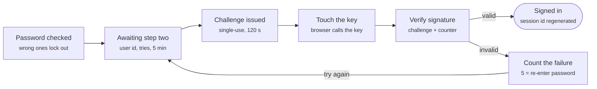

# YubiKey & Passkey Two-Step Sign-In — Implementation Guide

Source: Argus

## Overview

Users sign in with their password, then touch a registered YubiKey (or use a passkey) as the optional second step. Built and tested in the Argus expense-request app (plain PHP 8.2+, MySQL 8, Apache, no framework); this guide is written so another Claude session can port it to a different PHP project.

What the user gets:

- **Two-step sign-in is optional**, per person, managed on their own profile page.
- **Methods, any mix:** a security key such as a YubiKey (FIDO2/WebAuthn), a passkey on their computer or phone (Windows Hello, Touch ID), or 6-digit codes from an authenticator app (TOTP).
- **Ten one-time recovery codes**, created with the first method and removed with the last.
- **Touch only:** the key is not asked for its PIN; the password is already the first factor.
- **Every change emails the user a notice**, signs out their other sessions, and is written to the audit log.
- **Lost key and codes:** an admin reset clears the password, every key, the app and the codes, and emails a new set-password link.

This guide covers the security-key and passkey part in full. Authenticator-app codes and recovery codes are summarised where they interact.

## Architecture and files

The protocol checks come from the library **lbuchs/webauthn** (Composer `lbuchs/webauthn:^2.2`, MIT, needs only PHP 8 and the OpenSSL extension). Do not hand-roll WebAuthn: the library verifies the origin, challenge, relying-party hash, signature and signature counter. Everything else is about 400 lines of app code.

| Piece | Argus file | Job |
| --- | --- | --- |
| Key service | `src/Domain/SecurityKeyService.php` | Builds browser options, verifies registration and sign-in, stores keys, keeps single-use challenges in the session |
| Two-step service | `src/Domain/TwoFactorService.php` | Decides if two-step is on (app or any key), checks app/recovery codes, creates and drops recovery codes |
| Profile controller | `src/Http/Controllers/AccountController.php` | Add key (password re-check, then options, then finish), remove key, remove app, turn everything off |
| Sign-in controller | `src/Http/Controllers/AuthController.php` | Holds a "password OK, waiting for second step" session state; key options and verify endpoints |
| Auth helpers | `src/Support/Auth.php` | `checkPassword`, `completeLogin`, `verifyCurrentPassword`, `registerFailedSecondStep`, `bumpSessionVersion` |
| Browser script | `public/assets/webauthn.js` | Decodes options, calls `navigator.credentials.create/get`, posts the results back |
| Templates | `templates/account.twig`, `templates/auth/verify.twig` | Profile section (keys table, add form) and the sign-in code step ("Use security key" button) |
| Migration | `db/migrations/012_security_keys.sql` | The `user_security_keys` table |

Routes (all POST except the pages):

| Route | Who | Returns |
| --- | --- | --- |
| `/account/keys/options` | signed-in user, needs current password | JSON registration options |
| `/account/keys` | signed-in user | JSON `{ok, redirect}` after saving the key |
| `/account/keys/{id}/remove` | signed-in user, needs current password | redirect |
| `/login/verify/key/options` | user waiting at the second step | JSON sign-in options |
| `/login/verify/key` | user waiting at the second step | JSON `{ok, redirect}` and the session is signed in |

The JSON endpoints are called with `fetch()` and a `FormData` body that includes the page's CSRF token, so the app's normal CSRF check applies unchanged.

## Database schema

One new table holds each person's keys; two columns on `users` and a recovery-code table support the rest of two-step sign-in.

```sql
CREATE TABLE IF NOT EXISTS user_security_keys (
  id            INT UNSIGNED AUTO_INCREMENT PRIMARY KEY,
  user_id       INT UNSIGNED NOT NULL,
  name          VARCHAR(80) NOT NULL,             -- the person's own label
  credential_id VARCHAR(512) NOT NULL,            -- base64 of the authenticator's credential id
  public_key    TEXT NOT NULL,                    -- PEM; verifies each sign-in signature
  sign_count    INT UNSIGNED NOT NULL DEFAULT 0,  -- authenticator counter (clone detection)
  aaguid        VARCHAR(64) DEFAULT NULL,         -- authenticator model id, informational
  created_at    DATETIME NOT NULL DEFAULT CURRENT_TIMESTAMP,
  last_used_at  DATETIME DEFAULT NULL,
  UNIQUE KEY uq_credential (credential_id(255)),
  KEY idx_user (user_id),
  FOREIGN KEY (user_id) REFERENCES users(id) ON DELETE CASCADE
) ENGINE=InnoDB DEFAULT CHARSET=utf8mb4;
```

| Column or table | Why it exists |
| --- | --- |
| `credential_id` | Sent back by the key at sign-in; used to find the right public key. Unique, so one physical key can't be registered twice |
| `public_key` | The library returns it as PEM at registration; it's the only secret-free thing needed to verify signatures, so it is stored in plain text |
| `sign_count` | The key's counter must go up on every use; a counter that doesn't suggests a cloned key and the library refuses it |
| `users.session_version` (INT, default 0) | Bumped on any security change; sessions carry the version they started with and are dropped when it no longer matches, signing out other devices |
| `users.totp_secret`, `totp_enabled_at`, `totp_last_step` | The authenticator-app method (secret encrypted at rest with an app key) |
| `user_recovery_codes` (`user_id`, `code_hash`, `used_at`) | Ten one-time codes, stored only as `password_hash()` values |

Nothing about a key is secret on the server: a database leak does not let anyone sign in with it. The private key never leaves the YubiKey.

## Server flows

Both flows are two round trips: the server issues options with a fresh challenge, the browser asks the key to sign it, and the server verifies the result against that challenge, which is then thrown away.



A bad touch or wrong key loops back to the second step; five failures send the user back to the password.

**Registration** (profile page):

1. `POST /account/keys/options` with the current password. Wrong password counts toward the account lockout and returns 422. Right password returns options and stores the challenge in the session.
2. Browser calls `navigator.credentials.create()`; the user touches the key.
3. `POST /account/keys` with the key's response. The server verifies it, stores the key, creates recovery codes if this is the first method, bumps `session_version` (keeping the current session), emails a notice and audits it.

**Sign-in:**

1. Password form posts as usual. If the password is right and the user has an app or any key, the session gets `2fa_pending = {id, at, tries}` instead of being signed in, and the browser goes to the second-step page.
2. "Use security key" posts to `/login/verify/key/options`; the server returns options listing only that user's credential ids.
3. Browser calls `navigator.credentials.get()`; the user touches the key.
4. `POST /login/verify/key`; on success the session is signed in (session id regenerated). On failure `tries` goes up, the failure counts toward the account lockout, and after 5 the user must re-enter the password. The pending state also expires after 5 minutes.

The core of the key service (Argus `SecurityKeyService`, trimmed; `Db`, `Config` are the app's own helpers):

```php
use lbuchs\WebAuthn\WebAuthn;
use lbuchs\WebAuthn\WebAuthnException;

private static function webAuthn(): WebAuthn
{
    // Relying party id = the site's host name: keys only work on this site.
    $rpId = (string) parse_url(Config::get('app.base_url'), PHP_URL_HOST);
    return new WebAuthn('Argus — Southeastern NY Library Resources Council', $rpId, null, false);
}

public static function registrationOptions(array $user, string $kind = 'key'): object
{
    $wa = self::webAuthn();
    $args = $wa->getCreateArgs(
        pack('N', (int) $user['id']), $user['email'], $user['name'],
        60,                                  // timeout, seconds
        false,                               // resident key not required
        false,                               // user verification not required
        $kind === 'passkey' ? false : true,  // true = cross-platform (YubiKey), false = platform (Windows Hello)
        self::credentialIds((int) $user['id']) // exclude keys already registered
    );
    // Touch only: the library sends "preferred", which makes a YubiKey with a PIN ask for it.
    $args->publicKey->authenticatorSelection->userVerification = 'discouraged';
    self::rememberChallenge('reg', $wa, (int) $user['id']);
    return $args;
}

public static function finishRegistration(array $user, string $name, string $clientDataJSON, string $attestationObject): void
{
    $challenge = self::takeChallenge('reg', (int) $user['id']);
    try {
        // requireUserVerification=false, requireUserPresent=true, failIfRootMismatch=false
        $data = self::webAuthn()->processCreate($clientDataJSON, $attestationObject, $challenge, false, true, false);
    } catch (WebAuthnException $e) {
        throw new \RuntimeException('That security key couldn’t be added: ' . $e->getMessage());
    }
    // INSERT user_id, name, base64_encode($data->credentialId), $data->credentialPublicKey (PEM),
    //        $data->signatureCounter, bin2hex($data->AAGUID); refuse a duplicate credential_id.
}

public static function loginOptions(array $user): object
{
    $wa = self::webAuthn();
    $args = $wa->getGetArgs(self::credentialIds((int) $user['id']), 60, true, true, true, true, true, false);
    $args->publicKey->userVerification = 'discouraged';
    self::rememberChallenge('login', $wa, (int) $user['id']);
    return $args;
}

public static function verifyLogin(array $user, string $credentialId, string $clientDataJSON, string $authenticatorData, string $signature): bool
{
    $challenge = self::takeChallenge('login', (int) $user['id']);
    // SELECT * FROM user_security_keys WHERE user_id = ? AND credential_id = base64_encode($credentialId)
    if (!$key) { return false; }
    $wa = self::webAuthn();
    try {
        $wa->processGet($clientDataJSON, $authenticatorData, $signature, $key['public_key'],
                        $challenge, (int) $key['sign_count'], false, true);
    } catch (WebAuthnException) {
        return false;
    }
    // UPDATE sign_count = $wa->getSignatureCounter(), last_used_at = NOW()
    return true;
}

private static function rememberChallenge(string $kind, WebAuthn $wa, int $userId): void
{
    $_SESSION['webauthn_' . $kind] = [
        'challenge' => base64_encode($wa->getChallenge()->getBinaryString()),
        'user' => $userId, 'at' => time(),
    ];
}

// Single-use and short-lived: removed as it is read, valid 120 s, bound to the user.
private static function takeChallenge(string $kind, int $userId): string
{
    $c = $_SESSION['webauthn_' . $kind] ?? null;
    unset($_SESSION['webauthn_' . $kind]);
    if (!is_array($c) || (int) $c['user'] !== $userId || time() - (int) $c['at'] > 120) {
        throw new \RuntimeException('That took too long or the page was out of date — try again.');
    }
    return (string) base64_decode($c['challenge'], true);
}
```

Controllers decode the browser's base64 fields with `base64_decode($_POST[$k], true)` before passing them in. The options object is returned as JSON as-is: the library serialises binary values as `=?BINARY?B?<base64>?=` strings, which the browser script converts back.

## Browser code

One plain script, no build step, handles both pages: a form marked `data-webauthn-register` on the profile page and a button marked `data-webauthn-login` on the second-step page. Progress and errors go to an element marked `data-webauthn-status` with `role="status" aria-live="polite"`, so screen readers hear them.

```js
// "=?BINARY?B?<base64>?=" (how lbuchs/webauthn serialises binary) -> ArrayBuffer, recursively.
function toBuffers(obj) {
  if (typeof obj === 'string') {
    var m = obj.match(/^=\?BINARY\?B\?(.*)\?=$/);
    if (!m) return obj;
    var bin = atob(m[1]), buf = new Uint8Array(bin.length);
    for (var i = 0; i < bin.length; i++) buf[i] = bin.charCodeAt(i);
    return buf.buffer;
  }
  if (Array.isArray(obj)) return obj.map(toBuffers);
  if (obj && typeof obj === 'object') {
    var out = {};
    Object.keys(obj).forEach(function (k) { out[k] = toBuffers(obj[k]); });
    return out;
  }
  return obj;
}
function b64(buffer) {
  var bytes = new Uint8Array(buffer), s = '';
  for (var i = 0; i < bytes.length; i++) s += String.fromCharCode(bytes[i]);
  return btoa(s);
}
// FormData POST with the CSRF token; always resolves to {ok, error?, ...}.
function post(url, fields) { /* fetch(url, {method:'POST', body: FormData, credentials:'same-origin'}) -> JSON */ }

// Register (profile page)
post('/account/keys/options', { _csrf: csrf, current_password: pw, kind: kind })
  .then(function (r) { if (!r.ok) throw new Error(r.error); return navigator.credentials.create(toBuffers(r.options)); })
  .then(function (cred) {
    return post('/account/keys', { _csrf: csrf, name: name,
      clientDataJSON: b64(cred.response.clientDataJSON),
      attestationObject: b64(cred.response.attestationObject) });
  })
  .then(function (r) { if (!r.ok) throw new Error(r.error); location.assign(r.redirect.replace('#', '?k=' + Date.now() + '#')); });

// Sign in (second-step page)
post('/login/verify/key/options', { _csrf: csrf })
  .then(function (r) { if (!r.ok) throw new Error(r.error); return navigator.credentials.get(toBuffers(r.options)); })
  .then(function (cred) {
    return post('/login/verify/key', { _csrf: csrf,
      credentialId: b64(cred.rawId),
      clientDataJSON: b64(cred.response.clientDataJSON),
      authenticatorData: b64(cred.response.authenticatorData),
      signature: b64(cred.response.signature) });
  })
  .then(function (r) { if (r.redirect) location.href = r.redirect; else if (!r.ok) throw new Error(r.error); });
```

Things that bit during the build:

- **Reload after adding a key:** going to the same page with only a different `#fragment` doesn't reload it. Add a throwaway query parameter, as above.
- **Translate browser errors:** `NotAllowedError` means cancelled or timed out, `InvalidStateError` means that key is already registered, `SecurityError` means the page isn't on the expected https host.
- **Feature-detect:** if `window.PublicKeyCredential` is missing, disable the buttons and say so, and keep the code box usable.
- **CSRF token for fetch:** the page template needs the raw token (Argus exposes `csrf_token` in every page's context) for the button's `data-csrf` attribute.
- **Script placement in Twig:** put the `<script>` inside the content block. One version landed after the title block's `` and ended up in the page title.

## Security decisions and gotchas

Each choice below was made on purpose; keep them when porting unless the new project has a reason to differ.

| Decision | Setting | Why |
| --- | --- | --- |
| Relying-party id | Host name from the app's base URL (`argus.example.org`) | Keys are bound to it: they won't work on another host, an IP address, or plain http. A phishing site can't use them |
| HTTPS only | Browser enforces it | WebAuthn needs a secure context; `localhost` is the only exception for development |
| User presence | Required (`requireUserPresent = true`) | The touch proves a person is there |
| User verification | `discouraged` on create and get, not required on verify | Touch only, no key PIN. The library defaults to `preferred`, which makes a PIN-protected YubiKey ask for it; the password is already the first factor |
| Attachment | `cross-platform` for "YubiKey or other security key", `platform` for "Passkey on this computer or phone" | Sends the browser straight to the right prompt; sign-in accepts any registered credential |
| Resident key | Not required | It's a second factor, not passwordless sign-in, so the key needn't store an account on itself |
| Attestation roots | Not checked (`failIfRootMismatch = false`) | No need to restrict key makers; every FIDO2 key is accepted |
| Clone detection | Stored `sign_count` passed as `prevSignatureCnt` | The library refuses a counter that doesn't increase (both zero is allowed, for keys without counters) |
| Challenges | Session, single-use, 120 s, bound to the user id | Stops replay and cross-account use |
| Adding or removing a key | Current password required | A hijacked session can't add the attacker's own key |
| Failed second steps | Count toward the same lockout as wrong passwords; 5 tries then re-enter password | Stops guessing |
| After any change | `session_version` bumped, notice emailed, audit entry | Other devices are signed out and the person hears about it |
| Admin reset | Deletes keys, app secret and recovery codes along with the password | The way back in when everything is lost |

Gotchas seen in practice:

- **Password-manager extensions take over the prompt.** Bitwarden (and 1Password, Dashlane) intercept `navigator.credentials.create()` and offer to save a passkey in the vault. To use the YubiKey: pick "Use your device or hardware key" in the popup, or turn off Bitwarden's Settings → Notifications → "Ask to save and use passkeys". A page can't stop this. Saving the passkey in the vault does work, but puts both factors in one place.
- **Recovery codes when keys are the first method:** the registration endpoint returns JSON, so the new codes are put in the session and shown once on the next profile page load.
- **"On" means app or key:** guards that used to check only the app (for example "you already have two-step on, can't add an app") must check the app specifically, or a keys-only user can never add an app.
- **A 6-digit entry on a keys-only account** must be rejected before trying to decrypt a missing app secret.

## Testing

A software authenticator script proves the server side without a physical key: it makes a real P-256 key pair, builds the same registration and sign-in data a YubiKey sends, and feeds it to the library exactly as the key service does. In Argus every check passed:

| Case | Result |
| --- | --- |
| Registration | Accepted; credential id matches, counter 1, public key returned as PEM |
| Sign-in | Accepted; counter advanced to 2 |
| Replayed counter (cloned key) | Refused: "signature counter not valid" |
| Wrong origin (phishing site) | Refused: "invalid origin" |
| Wrong challenge | Refused: "invalid challenge" |
| Signature from a different key | Refused: "invalid signature" |

The script (run with `php wa_test.php` from a folder where `composer require lbuchs/webauthn` has been run; change `$rpId` and `$origin` to the new site):

```php
<?php
require __DIR__.'/vendor/autoload.php';
use lbuchs\WebAuthn\WebAuthn;
function cbor($v): string {               // minimal CBOR encoder (ints, byte/text strings, maps)
  $head = function(int $major, int $n): string {
    if ($n < 24) return chr(($major<<5)|$n);
    if ($n < 256) return chr(($major<<5)|24).chr($n);
    return chr(($major<<5)|25).pack('n',$n);
  };
  if (is_int($v)) return $v >= 0 ? $head(0,$v) : $head(1,-1-$v);
  if (is_array($v) && isset($v['__bytes'])) return $head(2,strlen($v['__bytes'])).$v['__bytes'];
  if (is_string($v)) return $head(3,strlen($v)).$v;
  if (is_array($v)) { $o=$head(5,count($v)); foreach($v as $k=>$x){ $o.=cbor(is_string($k)&&preg_match('/^-?\d+$/',$k)?(int)$k:$k).cbor($x);} return $o; }
  throw new Exception('cbor');
}
$b = fn($s) => ['__bytes'=>$s];
$b64u = fn($s) => rtrim(strtr(base64_encode($s),'+/','-_'),'=');
$rpId='argus.example.org'; $origin='https://argus.example.org';
$wa = new WebAuthn('Test', $rpId, null, false);

// registration
$wa->getCreateArgs(pack('N', 4), 'user@example.org', 'Test User', 60, false, false, true, []);
$challenge = $wa->getChallenge()->getBinaryString();
$key = openssl_pkey_new(['private_key_type'=>OPENSSL_KEYTYPE_EC,'curve_name'=>'prime256v1']);
$d = openssl_pkey_get_details($key)['ec'];
$credId = random_bytes(32);
$cose = cbor(['1'=>2,'3'=>-7,'-1'=>1,'-2'=>$b($d['x']),'-3'=>$b($d['y'])]);
$authReg = hash('sha256',$rpId,true).chr(0x41).pack('N',1).str_repeat("\0",16).pack('n',strlen($credId)).$credId.$cose;
$att = cbor(['fmt'=>'none','attStmt'=>[],'authData'=>$b($authReg)]);
$cd = json_encode(['type'=>'webauthn.create','challenge'=>$b64u($challenge),'origin'=>$origin]);
$data = $wa->processCreate($cd, $att, $challenge, false, true, false);
$pem = (string)$data->credentialPublicKey; $prev = (int)$data->signatureCounter;
echo "registered, counter $prev\n";

// sign-in: authData = rpIdHash | flags(UP) | counter; signature over authData || sha256(clientDataJSON)
function assertion($wa,$key,$rpId,$origin,$counter,$b64u,&$ch,$badOrigin=null,$badCh=null){
  $wa->getGetArgs([], 60, true, true, true, true, true, false);
  $ch = $wa->getChallenge()->getBinaryString();
  $auth = hash('sha256',$rpId,true).chr(0x01).pack('N',$counter);
  $cd = json_encode(['type'=>'webauthn.get','challenge'=>$b64u($badCh ?? $ch),'origin'=>$badOrigin ?? $origin]);
  openssl_sign($auth.hash('sha256',$cd,true), $sig, $key, OPENSSL_ALGO_SHA256);
  return [$cd,$auth,$sig];
}
[$cd,$auth,$sig] = assertion($wa,$key,$rpId,$origin,2,$b64u,$ch);
var_dump($wa->processGet($cd,$auth,$sig,$pem,$ch,$prev,false,true));   // true
$prev = $wa->getSignatureCounter();
$try = function($label,$fn){ try { $fn(); echo "$label: ACCEPTED (BAD)\n"; } catch (Throwable $e) { echo "$label: refused (", $e->getMessage(), ")\n"; } };
$try('replayed counter', function() use($wa,$key,$rpId,$origin,$b64u,$pem,$prev){ [$c,$a,$s]=assertion($wa,$key,$rpId,$origin,2,$b64u,$x); $wa->processGet($c,$a,$s,$pem,$x,$prev,false,true); });
$try('wrong origin', function() use($wa,$key,$rpId,$origin,$b64u,$pem,$prev){ [$c,$a,$s]=assertion($wa,$key,$rpId,$origin,9,$b64u,$x,'https://evil.example'); $wa->processGet($c,$a,$s,$pem,$x,$prev,false,true); });
$try('wrong challenge', function() use($wa,$key,$rpId,$origin,$b64u,$pem,$prev){ [$c,$a,$s]=assertion($wa,$key,$rpId,$origin,9,$b64u,$x,null,random_bytes(32)); $wa->processGet($c,$a,$s,$pem,$x,$prev,false,true); });
```

After the script passes, test with a real key: register a YubiKey on the profile page, sign out, sign in with password plus a touch, then try a key that isn't registered (it should be refused) and a recovery code.

## Porting checklist

Work through these in order in the new project; each step can be checked before the next.

- [ ] Confirm the site is served over HTTPS on a fixed host name, and note it: that host is the relying-party id. Keys registered on one host never work on another.
- [ ] Check the server has PHP 8+ with OpenSSL, then `composer require lbuchs/webauthn:^2.2`.
- [ ] Run the software-authenticator script from Testing with the new host in `$rpId` / `$origin`; all three refusals must print "refused".
- [ ] Add the `user_security_keys` table (Database schema); add `session_version` to the users table if the app has no way to sign out other sessions.
- [ ] Split sign-in into "check password" and "complete sign-in", so a correct password with two-step on leads to a pending state (user id, time, tries) instead of a session.
- [ ] Write the key service: `webAuthn()`, `registrationOptions()`, `finishRegistration()`, `loginOptions()`, `verifyLogin()`, single-use challenges, `remove()` and `removeAll()` (Server flows).
- [ ] Add the five routes, with the app's CSRF check on each and a password re-check before registering or removing a key.
- [ ] Make failed second steps count toward the app's existing login lockout, with a pending-state limit of 5 tries and 5 minutes.
- [ ] Add the browser script and the two page pieces: the profile form (name, password, YubiKey-or-passkey choice, live status line) and the "Use security key" button on the second-step page, keeping a code or recovery-code box beside it.
- [ ] Expose the raw CSRF token to page templates for the `fetch()` posts.
- [ ] Generate recovery codes with the first method and delete them with the last; show new codes exactly once.
- [ ] On every key change: bump the session version (keeping the current session), email the user a notice, write an audit entry.
- [ ] Make the admin "reset account" path delete keys too.
- [ ] Test with a real YubiKey: register, sign out, sign in with a touch, try an unregistered key, use a recovery code. If a password manager's popup appears, use its "hardware key" option or switch off its passkey prompts.

Open question for the new project: whether security keys alone (no password) should ever be allowed. Argus keeps the password as the first step; passwordless sign-in would need resident keys and user verification turned on, and a different sign-in page.
